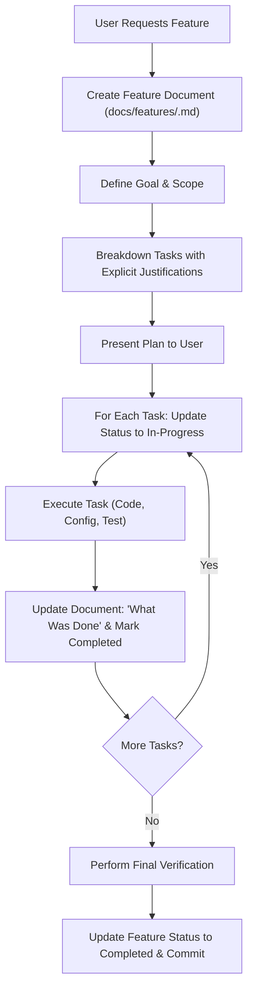

# Feature Lifecycle & Documentation Workflow

This skill establishes a disciplined, traceable workflow for implementing features across any project. Whenever a feature is requested, the agent must document the objective, break down the work into justified tasks, and continuously record execution details ("what was done") as work progresses.

---

## 1. Core Principles

1. **Document-First**: Never execute feature changes without first establishing the feature document.
2. **Explicit Justification**: Every single task in the breakdown must state *why* it is needed, not just *what* to do.
3. **Living Audit Trail**: As each task is worked on, the document must be updated with the exact details of what was done, files touched, commands executed, and verification outcomes.
4. **Idempotency & Clean Commits**: Keep the feature document version-controlled alongside the implementation code following project git conventions.

---

## 2. Standard Workflow



### Step 1: Document Inception
When a feature is requested:
1. Determine the feature slug (e.g., `user-authentication`, `export-pdf-report`, `karaf-cluster-monitoring`).
2. Identify or create the project's feature docs directory:
   - Preferred: `docs/features/<feature-slug>.md`
   - Alternative (if repository uses flat docs): `docs/<feature-slug>.md`
3. Initialize the document using [Feature Template](./resources/feature-template.md).
4. Fill in:
   - **Feature Name & Metadata**: Title, date, target branch/version.
   - **Goal & Overview**: Precise statement of the problem solved, business/technical value, and boundary conditions.
   - **Task Breakdown with Justification**: Deconstruct the feature into logical, sequential tasks. **Every task must have an explicit "Justification" entry** answering:
     - *Why is this task necessary?*
     - *What dependency or requirement does it satisfy?*
     - *What risks does it mitigate?*

### Step 2: Incremental Execution & Live Updates
Work through tasks sequentially or logically:
1. **Prior to starting a task**:
   - Mark the task status as `[-] In Progress`.
2. **Executing the task**:
   - Perform the code modifications, tests, or configurations.
3. **Immediately after completing the task**:
   - Update the task status to `[x] Completed`.
   - In the task's **What Was Done** section, record:
     - Specific files created, modified, or removed.
     - Key configuration flags or code logic introduced.
     - Commands executed (e.g., build commands, test runs, syntax checks) and their results.
     - Any deviations from the initial plan and why they were necessary.

### Step 3: Verification & Sign-off
1. Run final automated tests, linters, syntax checks, or dry-runs.
2. Record the test output and verification evidence in the document's **Verification & Validation** section.
3. Update the overall feature status in the document metadata to `Completed`.
4. Stage and commit the feature document together with the code changes (e.g., `feat(<scope>): ...`).

---

## 3. Mandatory Document Structure

Every feature document must follow this structure (see [template](./resources/feature-template.md)):

```markdown
# Feature: [Feature Name]

- **Status**: [Draft | In Progress | Completed]
- **Date**: YYYY-MM-DD
- **Author/Agent**: [Name / AI Assistant]
- **Target Components**: [e.g., backend, UI, playbook, role]
- **Document Path**: `docs/features/<feature-slug>.md`

## 1. Goal & Overview
### 1.1 Objective
[Clear, concise description of what the feature achieves]

### 1.2 Motivation & Value
[Why this feature is needed and what problem it solves]

### 1.3 Scope & Acceptance Criteria
- [ ] Criterion 1
- [ ] Criterion 2

## 2. Task Breakdown & Justifications

### Task 1: [Short Task Title]
- **Status**: [x] Completed / [-] In Progress / [ ] Pending
- **Justification**: [EXPLICIT: Why this task is required and what it enables]
- **Affected Files/Components**: `path/to/file`
- **What Was Done**:
  - [Detailed summary of changes made]
  - [Commands run and outcomes]

### Task 2: [Short Task Title]
- **Status**: [ ] Pending
- **Justification**: [EXPLICIT: Why this task is required and what it enables]
- **Affected Files/Components**: `path/to/file`
- **What Was Done**:
  - Pending execution...

## 3. Verification & Validation
- [Verification step, command run, test output]

## 4. Summary & Lessons Learned
- [Final summary once all tasks are completed]
```

---

## 4. Examples & References

- [Reusable Feature Document Template](./resources/feature-template.md)
- [Complete Real-World Example](./examples/sample-feature-doc.md)
